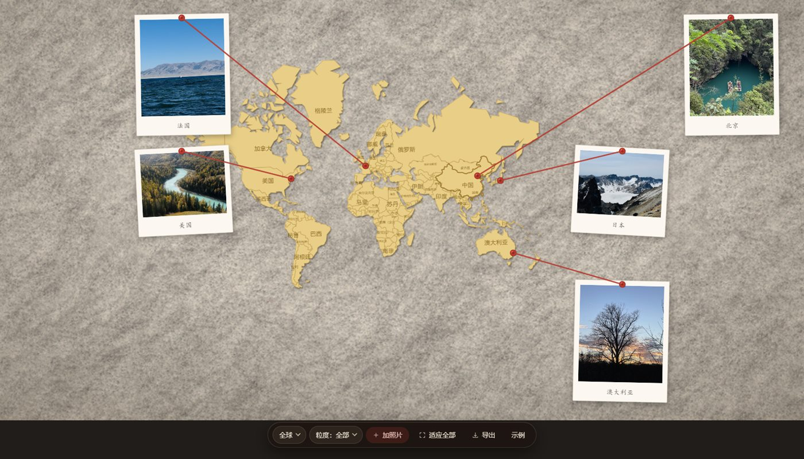
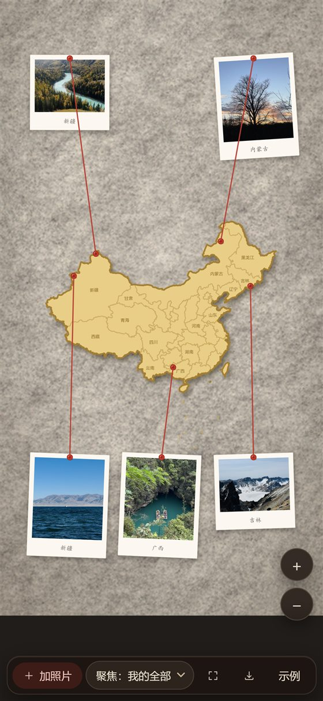

# 照片地图墙 · Photo Map Wall

把旅行照片还原成一面实体纪念墙：**毛毡板 + 实心地图件 + 红色毛线 + 拍立得**。

上传几张照片，页面自动读出照片里的 GPS，把大头针钉在地图上对应的位置，再把拍立得照片绕着地图排一圈，用红线一张张连起来 —— 线拉直、压在照片之上、彼此绝不交叉。点一下照片就能放大看原图。

纯前端，单文件，零依赖，断网可用。

**在线试用：<https://wall.orange0323.dpdns.org>** （备用：<https://photo-map-wall.pages.dev>）


---

## 目录

- [特性](#特性)
- [快速开始](#快速开始)
- [怎么用](#怎么用)
- [实现要点](#实现要点)
- [自己重新构建](#自己重新构建)
- [测试](#测试)
- [数据来源与许可](#数据来源与许可)
- [已知限制](#已知限制)
- [项目文档](#项目文档)

---

## 特性

- **照片带定位** —— 解析 JPEG 里的 EXIF GPS（度分秒 → 十进制度），钉到地图上的真实位置；没有 GPS 的照片按顺序分配到常用城市。
- **自动起名** —— 经纬度 → 就近城市（39 城表，120 km 内用城市名）→ 否则落到省（35 个省级面做点在多边形内判定）；出国了就按国家命名（175 国边界，不用「最近的中国城市」凑）。没有 GPS 的照片会标一个「位置待确认」角标，提醒你这张是猜的。
- **中国 / 全球两档** —— 左边「地图范围」可在**中国**和**全球**之间切。世界边界（Natural Earth 110m，175 国）构建时内联进 `index.html`，仍是零请求；上传的照片只要有国外的，会自动切到全球档，针钉在真实经纬度上。
- **照片绕地图一圈** —— 卡片四周留四条走廊，走廊里摆**等大槽位**；槽位与照片各按「绕卡片中心的方位角」排一个序，两序列之间做**全局保序指派**（DP，代价 = 方位角差）。锚点在外圈、图钉在内圈，同一次序配对时线段天然不相交。
- **红线零交叉** —— 指派完仍有交叉时跑优化器：既有「把一张挪到空槽位」也有「两张互换」，主目标总交叉数、次目标总线长，随后用**确定性扰动重启**（固定步长伪随机，同一批照片每次排出同一结果）。实测 7 种窗口尺寸 × 5/15/24/40 张 = 28 组，全部 `crossings: 0`、无重叠无出界，40 张渲染约 1.1–1.3 秒。
- **真毛毡、真地图件** —— 背景是真实毛毡照片（ambientCG CC0），地图是一块实心芥末黄的板件，带凸起投影、同色系省界、印着省名，没有纸卡白边。
- **一次上传自动全览，之后不再打扰** —— 第一次加照片时会自动缩放框住你所有的打卡点；之后再加照片**不动当前视野**，只让「适应全部」按钮亮一个红点，想看全就点它。你正盯着某个省的时候，没人愿意被替你把画面拽走。
- **两档取景** —— 左边选「地图范围」（中国 / 全球），右边选「缩放粒度」（全部 / 省 / 城市），选完自动飞到对应取景。只有示例照片时粒度是灰的。
- **画布跟随窗口** —— `viewBox` 按窗口比例实时计算，不拉伸、不留黑边，任何尺寸下照片都不被裁；窄屏自动转成竖幅画布（地图占满宽度）。
- **地图可缩放平移** —— 滚轮缩放、拖动平移，「适应全部」一键回到全览，还能按省聚焦。
- **手机能用** —— 单张照片不会把地图放大成区域级，工具条在窄屏自动折成两行、按钮只留图标，双指捏合缩放，右下角还有 +/− 按钮（触屏没有滚轮）。`dvh` + `env(safe-area-inset-bottom)` 让 iOS Safari 的地址栏和 home 条不压住内容。
- **点照片看大图** —— 白边拍立得样式的大图，可改地点、回原位、移除。
- **导出 PNG** —— 高度固定 1200，宽度跟随画布比例，直接序列化 SVG 上 canvas。
- **刷新不丢** —— 照片（原图）、经纬度、地点名存在浏览器本地 IndexedDB 里，关掉页面再打开墙还在。
- **同一面墙（云端）** —— 光有本地还不够：换个浏览器、换台设备，墙就没了。所以另存一份到 Cloudflare（Pages Functions + KV），身份是**本机自生成的 128 位 key**（localStorage + cookie 双写，跟着设备不跟网络），换设备时用 12 位「同步码」（`XXXX-XXXX-XXXX`）接回来。点工具条上的「同步」看当前状态和同步码。
- **「看示例」只是借看** —— 点它不会动你自己的照片，再点一次就回来。

| 15 张照片 | 放大看 | 宽窗口 |
|---|---|---|
|  |  |  |

切到「全球」档（下面这张是拿 5 张真照片各注入一个国外坐标拍的：巴黎 / 纽约 / 东京 / 悉尼 / 北京，上传后范围自动切到全球，地点按国家命名）：



手机上（393×852，竖幅画布、工具条收成图标、右下角 +/−）：

 

---

## 快速开始

直接双击 **`index.html`**。

不需要 `npm install`，不需要起服务器，也不需要联网 —— 地图边界、毛毡纹理、示例照片全部以 base64 内联在这一个文件里。

想放到网站上，把 `index.html` 传到任意静态托管即可（Cloudflare Pages、GitHub Pages、对象存储都行）。只有这一个文件是运行必需的。

> 直接用 `file://` 打开也行：数据全部内联，没有任何 `fetch`，不会撞上 CORS。

### 部署到 Cloudflare Pages

```bash
node src/build.mjs dist/index.html            # 产物只有这一个文件
npx wrangler pages project create photo-map-wall --production-branch=main
npx wrangler pages deploy dist --project-name=photo-map-wall --branch=main
```

之后再要发布新版本，只需要重复最后一条。自定义域名在 Pages 项目里加，DNS 那边一条 CNAME 指到 `<project>.pages.dev`（橙色小云朵开着）即可。

---

## 怎么用

1. 点「**+ 加照片**」，多选照片。带 GPS 的会自动落到地图上；没有 GPS 的会按顺序分到常用城市。
2. 滚轮缩放地图，拖动地图平移；点「**适应全部**」回到全览。顶部两个下拉是取景器：左「地图范围」（中国 / 全球）、右「缩放粒度」（全部 / 省 / 城市）。照片里只要有一张在国外，范围会自己切到「全球」。手机上改用**双指捏合**缩放，或点右下角的 **+ / −**。
3. 点任意一张拍立得 → 打开大图预览，底部可以改「地点」、点「回原位」清掉拖动偏移、点「移除」删掉这张。
4. 照片可以**拖动**，拖走后红线实时跟着走，预览不会被误触发。
5. 点「**导出**」存成 PNG。

---

## 实现要点

**全部用 SVG 画。** 照片是 `<image>` + `clipPath`，红线是 `<path>`，地图是 `<path>`。导出时把 SVG 序列化 → `new Image()` → `canvas.toBlob()`，因此不需要 html2canvas 之类的依赖。

**画布尺寸。** 高度基准 `BH0 = 1000`，宽度 `BW = round(BH0 * 可视宽 / 可视高)`，随后把 `BW/BH` 写进 `viewBox` —— SVG 宽高比永远等于可视区，`preserveAspectRatio` 不会留黑边。窄屏（`BW < 830`）会把宽度钉在 830、改为**加高 `BH`**（上限 2800），于是手机竖屏拿到的是一个 830×1580 的竖幅画布，而不是把 1600×1000 的横画布塞进窄条。地图件尺寸跟着 `BW` 走（`CARD.w = clamp(BW * 0.84, 300, 700)`），桌面仍是 700×470。窗口尺寸变化时整体重建（150 ms 防抖），`view` 是卡片局部坐标，所以重建后缩放状态不丢。

**投影用墨卡托。** `u = lon`，`v = -ln(tan(π/4 + lat·π/360))·180/π`。经纬度直接当平面坐标画会让新疆和东北被横向拉长，墨卡托在中国范围内的形变可以接受（长宽比 1.31，真实约 1.34）。

**排布：走廊 + DP + 2-opt。**
1. 地图卡片居中，四边各留一条走廊（上、右、下、左，四角归左右）。
2. 每条走廊内生成统一尺寸的槽位网格 —— 槽位尺寸取所有照片旋转后外接框的最大值，所以任意照片放任意槽位都不会重叠、不会出界。
3. 槽位按绕卡片中心的方位角排序；照片按图钉的轴向坐标排序（右侧/左侧按纬度、上侧/下侧按经度）。两条序列之间用 DP 做保序最小代价指派。
4. DP 只保证「顺序一致」，不保证「线不相交」。最后跑 2-opt：任取一对红线，若真实贝塞尔折线相交就交换它们对应的照片，且只接受总长下降的交换 —— 有界单调，必然终止。

**尺寸自适应降档。** 照片内容宽从 200 px 开始，按 `200, 190, 180, …, 42`（19 档）逐档尝试，取第一个能把所有照片排下且满足「任意两张不重叠、全部在画布内」的档位。真到 42 px 还排不下（极端数量的照片），退回 `cascadeLayout()`：多出来的照片沿同一槽位阶梯错开叠放，宁可叠一点也不能出界或消失。

**线是直的。** 早期版本给红线加了重力下垂（二次贝塞尔控制点下移），实测像流程图的反面 —— 线从照片中间穿过去很乱，所以改回直线。绘制顺序是「照片 → 红线」，红线压在照片上面。

---

构建产物 `index.html` 现在是 1,213,031 B（单文件，已内联全部地图数据、毛毡底图与 5 张示例照片）。

## 自己重新构建

```bash
node src/build.mjs              # 产出 index.html
node src/build.mjs out.html     # 或者写到指定文件
```

`src/build.mjs` 把六个占位符替换进 `src/index.template.html`：

| 占位符 | 来源 |
|---|---|
| `//__CHINA_DATA__` | `data/china_coords.js` |
| `//__PROV_DATA__` | `data/provinces.js` |
| `//__WORLD_DATA__` | `data/world.js` |
| `"__FELT_URI__"` | `assets/felt-final.jpg`（base64） |
| `/*__DEMO_DATA__*/[]` | `assets/demo5/*.jpg`（base64 + 真实 GPS） |
| `const CITIES_W = /*__CITIES__*/[];` | `data/cities.js` |

要改界面就改 `src/index.template.html`，然后重新构建 —— **不要直接改 `index.html`**，它是构建产物。

省界数据可以离线重建（首次会联网抓一次 GeoJSON 并缓存）：

```bash
node tools/gen_provinces.mjs    # data/china_boundary_full.json（缓存）→ data/provinces.js
node tools/gen_labels.mjs       # 给每个省算省名锚点 + 内切圆半径，写回 data/provinces.js
```

示例照片从 iPhone 的 HEIC 转出（需要 `pillow-heif`，转换时会**保留 EXIF GPS**）：

```bash
python tools/heic2jpg.py "C:\path\to\heic" assets/demo5
```

---

## 测试

测试全部是 Chrome DevTools Protocol 直连 —— 不需要 Playwright/Puppeteer，Node 18+ 自带 `fetch` 和 `WebSocket`。Chrome 路径可以用环境变量 `CHROME_PATH` 指定。

```bash
node test/gen-testimg.mjs        # 生成测试图（7 张不同长宽比 + 15 张压测副本，纯 Node 写 PNG）
node test/gen-exif-cases.mjs     # 生成 9 张带已知经纬度的 EXIF 样本

node test/cdp-shot.mjs 1600 1000 shot.png   # 冒烟：打开、自检、截图
node test/cdp15.mjs                         # 15 张压测：排布 + 导出落盘
node test/cdp-cross.mjs                     # 独立复算红线交叉（不看页面自检，自己算一遍）
node test/cdp-reflow.mjs                    # 6 种窗口尺寸下重排是否越界/裁剪
node test/cdp-reorder.mjs                   # 拖动排序：虚线落点、松手换位、名次持久化、自动排位恢复
node test/cdp-mobile.mjs                    # 手机竖屏 393×852：铺满/工具条/缩放按钮/单张全览/15 张压测
node test/cdp-ux.mjs                        # 交互契约：首次自动全览 / 二次上传不动视野 / 三档粒度 / 预览
node test/cdp-ux2.mjs                       # 交互契约（第二批）：看示例不动你的照片 / 拖动死区 / 删光不塌 / 坏文件提示
node test/cdp-stability.mjs                 # 稳定性矩阵：12 种尺寸 × 示例与 15 张 + 改窗抖动 + 增删 + 导出
node test/cdp-persist.mjs                   # 本地持久化：上传 → 刷新复原 → 看示例不清库（自带 http 服务器）
node test/cdp-sync.mjs                      # 云端「同一面墙」：换设备用同步码接回（自带 wrangler pages dev）
node test/cdp-world.mjs                     # 中国/全球两档：切档、国名、国外照片命名、自动切档、零交叉
node test/cdp-gran.mjs                      # 取景粒度四档：中国 全部/省/城市、全球 全部/大洲/国家/城市
node test/cdp-live.mjs                      # 线上冒烟：直接打公网 URL，三档视口
node test/api-cloud.mjs                     # 云端接口端到端：401、原图字节一致、同步码换 key、越权、413/400/404

node test/exif-node.mjs         # 把页面里的 parseExifGps 抠出来，在 node 里跑 9 个样本
node test/cdp-exif2.mjs         # 真实走一遍文件上传，确认定位落到正确城市

node test/dbg-x.mjs 40 2200 1100   # 排布诊断：N 张照片在指定尺寸下的交叉数/重叠/耗时（只读，不改页面状态）
node test/cdp-docs.mjs          # 不是断言：生成 README 里那张「全球档」截图（真照片 + 注入坐标）
```

`test/cdp-docs.mjs` 用的是「把真照片当载体、在 SOI 后插一个带 GPS 的 APP1」的做法（`test/_exif.mjs` 的 `injectGps()`），所以截图里是真实照片配虚构坐标，不会为了配图去伪造拍摄记录。

文档也能自检（链接是否指得通、反引号里的路径是否存在、`build.mjs` 的占位符数量和 README 说的是否一致、README 里的 `index.html` 字节数是否等于实际产物）：

```bash
node tools/check_docs.mjs
```

想把测试跑在线上版本而不是本地文件，加一个环境变量就行：

```bash
PMW_URL=https://wall.orange0323.dpdns.org node test/cdp-shot.mjs 1600 1000 live.png
```

`__selfTest()` 在页面里可随时调用，返回照片数量、省份数、国界环数、红线数、交叉数、每张照片的包围盒以及 `issues`（重叠/出界）列表 —— 上面的脚本都是围绕它做断言的。

---

## 数据来源与许可

- **中国国界 / 省界**：阿里云 [DataV.GeoAtlas](https://datav.aliyun.com/portal/school/atlas/area_selector)。`data/china_boundary.json` 是 `100000.json` 的原始快照；`data/china_coords.js` 是它经 Douglas-Peucker 简化后的版本（17 个环、1578 点，含海南、台湾与南海诸岛）；`data/provinces.js` 由 `tools/gen_provinces.mjs` 从 `100000_full.json` 生成（35 个省级面、4180 点）。
  > 地图仅用于**可视化示意与个人纪念**，不作为任何行政区划或国界的权威依据。
- **世界国界**：[Natural Earth](https://www.naturalearthdata.com/) 110m `admin_0_countries`（public domain）。`data/world_raw.geojson` 是原始快照，`data/world.js` 由 `tools/gen_world.mjs` 生成（175 国、7083 点、约 107 KB）。**边界按该数据集划分**（台湾单列、西撒哈拉与索马里兰等按 NE 口径）；要面向更广的受众时，这套口径需要按目标重新定，不能默认沿用。
- **世界城市**：[Natural Earth](https://www.naturalearthdata.com/) 10m `populated_places`（public domain）。`data/cities_raw.geojson` 是原始快照，`data/cities.js` 由 `tools/gen_cities.mjs` 生成（人口 ≥30 万或首都、同国同名取人口最大、每国最多 30 个 → 1018 城 / 169 国）。中文名取数据集的 `NAME_ZH`。
- **毛毡纹理**：ambientCG 的 `Fabric034`（CC0），裁切调色后内联。
- **示例照片**：作者本人拍摄，仅作展示样例。想换成自己的照片，改 `src/build.mjs` 里的 `DEMO_META` 再重新构建即可（改成空数组就是空墙）。

代码以 MIT 许可发布，见 [LICENSE](LICENSE)。

---

## 已知限制

- **只解析 JPEG 的 EXIF GPS**。PNG 没有 EXIF；微信/微博转发过的图片通常已被抹掉定位，这时候只能手动选城市（点照片改「地点」，或直接在墙上拖那枚针）。
- **HEIC 能不能加，取决于浏览器**。Safari 自己能解 HEIF，页面会在本地转成 JPEG 继续用（用户无感）；Chrome / 微信内置浏览器解不开，页面会明确告诉你「这几张是 HEIC」，并给出三条出路（换 Safari / 相机格式改「兼容性最佳」/ 相册里分享成 JPEG）。不是 HEIC 又打不开的，会单独说成「文件可能损坏或格式不支持」，不会混为一谈。
- **照片存在浏览器本地**（IndexedDB），换设备 / 换浏览器就是空的 —— 除了下面这条「同一面墙」。
- **「同一面墙」跟着设备走，不跟网络走**。身份是浏览器自己生成的 128 位随机 key（localStorage + cookie 双写），所以 Wi-Fi 和流量之间切换不影响；换设备时输入 12 位同步码接回。**没有做账号**，清掉浏览器数据 + 没存同步码 = 那面墙找不回来。
- **iOS Safari 的 ITP 会在 7 天不用后清掉站点数据**（加到主屏除外），云端那面墙不受影响，下次打开会自己拉回来。
- **`file://` 打开时本地持久化不生效** —— 文件源是不透明源，浏览器不给持久配额。双击打开能正常用，只是刷新回示例；放到任意 `https://` 静态托管上就正常。
- **云端只存压过的中等尺寸版本**（长边 1600、JPEG 0.8、约 200~400 KB），原图一直留在本机。Cloudflare KV 免费额度是 1 GB 存储 / 每天 1000 次写 / 10 万次读：传满一面 80 张的墙大约消耗 80 次写 + 若干次清单写，一天造十来面墙没问题；**长期归档原图请走 NAS**（见下）。
- **两台设备同时编辑同一面墙会「后写覆盖」**。清单是客户端整体覆盖写的（避开 KV 的读-改-写竞态），所以并发改会丢中间状态；同一个人的多设备接力用没问题。
- **手机上是「能用」而不是「为触屏重做」**。捏合缩放、+/− 按钮、两行工具条、拖动换位都有，但没有惯性拖动；一屏塞十几张照片时，窄屏上的拍立得会明显变小（走廊只有四条，槽位尺寸由最长那张照片决定）。
- **导出现在是 2× 出厂**：宽高按当前画布比例算，2400 高起，超过 3200 万像素会等比收，成品大于 1400 万像素时不再做 2× 超采样（手机上双倍绘制会 OOM）。
- **iOS 上导出的行为没有真机验证过**。导出走的是 `canvas.toBlob()` + `<a download>`，桌面 Chrome/Firefox/Edge 都能直接落盘；iOS Safari 对 blob 下载的处理历史上不统一，可能变成「新标签里打开图片」——那样长按也能存进相册，或者干脆用桌面浏览器导出。真机验证仍在 TODO。
- **手边没有城市的地方显示上一级**。中国境内按 39 个常用城市就近判（≤120 km 用城市名，否则省名）；全球档按 1018 个城市判（≤90 km 用城市名，否则国家名）。宁可显示「西藏」「法国」，也不编一个不存在的地名。
- **世界边界的口径来自 Natural Earth**。这是英文世界常见的数据集（台湾单列、索马里兰单列等）。个人纪念用没问题，但如果这个页面要给更广的人用，边界口径必须按目标受众重新定。
- **导出是光栅化 PNG**，不是矢量 PDF；画布越高清、照片越多，导出越慢。

### 云端额度与 NAS 的分工

| | 存什么 | 额度/寿命 | 用途 |
|---|---|---|---|
| 浏览器 IndexedDB | 原图 + 名次 + 经纬度 | 受 ITP 7 天限制 | 日常交互、导出（始终用原图） |
| Cloudflare KV | 长边 1600 的 JPEG | 1 GB / 每天 1000 写 | 换设备接回、跨设备看到同一面墙 |
| NAS（可选） | 原图 + `meta.json`（IP、机型、GPS、时间） | 自己硬盘 | 长期归档、看谁传了什么机型 |

KV 免费额度适合「自己用 + 几个朋友」，不适合当图床给陌生人用：80 张压缩图约 20~30 MB，一天造十来面墙会碰到日写上限，而原图归档本该是硬盘的活。NAS 那部分（`server/`，零依赖 Node + Docker）是单独的服务，部署说明见 `server/README.md`。

### 云端同一面墙的接口

`functions/api/wall/[[path]].js`（Cloudflare Pages Function，绑 KV 命名空间 `WALLS`）：

| 路由 | 作用 |
|---|---|
| `GET /api/wall/ping` | 探活（不需要 key） |
| `POST /api/wall/pair` | 用 12 位同步码换回 key |
| `GET /api/wall/index` | 拉这面墙的清单（含每张的 id / 地点 / 经纬度 / 名次） |
| `PUT /api/wall/blob?id=…` | 传一张压缩图（≤8 MB，幂等：同 id 覆盖） |
| `POST /api/wall/index` | 整体覆盖清单（≤80 张、≤256 KB），返回同步码 |
| `DELETE /api/wall/index` | 删整面墙（清单 + 同步码 + 所有图） |

key 走 `x-wall-key` 头。没有账号系统，所以服务端只做「拿着这把 key 才能读写这把 key 下的东西」，不做权限分级 —— 同步码等于共享密钥，别公开发。

---

## 项目文档

| 文件 | 内容 |
|---|---|
| [`docs/requirements.md`](docs/requirements.md) | 需求台账 —— 每一轮「要什么、为什么」 |
| [`docs/worklog.md`](docs/worklog.md) | 工作记录 —— 每一步做了什么、用了哪个脚本、踩了什么坑 |
| [`docs/acceptance.md`](docs/acceptance.md) | 验收记录 —— 每条需求的判据、实测数据、结论，含**未通过/未验证**项 |
| [`TODO.md`](TODO.md) | 还没做完的具体动作 |
| [`TIPS.md`](TIPS.md) | 这个项目里踩过的坑（Windows/Node、CDP、SVG、投影、排布算法、iOS） |

### 仓库结构

```
index.html              构建产物（唯一运行必需的文件）
src/index.template.html 应用源码
src/build.mjs           构建脚本
data/                   地图数据（中国国界 / 省界+省名锚点 / 世界国界 / 世界城市点）
                        —— 原始 *_raw.geojson 快照不入库，脚本会按需下载并缓存
assets/                 毛毡纹理 + 5 张示例照片
functions/              Cloudflare Pages Function：/api/wall/*（绑 KV `WALLS`）
server/                 可选的 NAS 原图备份服务（零依赖 Node + Docker）
tools/                  数据加工脚本（省界简化、省名锚点、世界国界/城市、HEIC 转码）
                        + 文档体检 check_docs.mjs、配图生成 make_docs_shots.mjs
test/                   CDP 自动化测试，全部可复跑
docs/                   需求 / 记录 / 验收 / 截图
```

> 脚本没有塞进一个 `scripts/` 目录，而是按「运行期源码 / 数据加工 / 测试」分开 —— 因为 `test/` 里的东西是要反复跑的，`tools/` 里的基本只跑一次。worklog 里每条结论都指向具体脚本路径。
