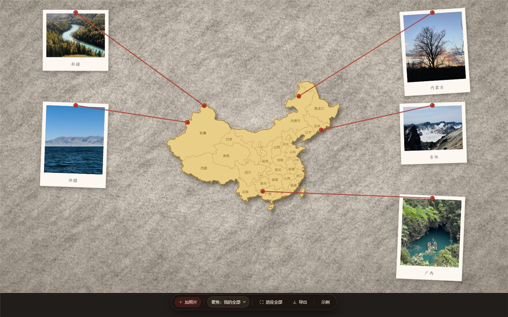
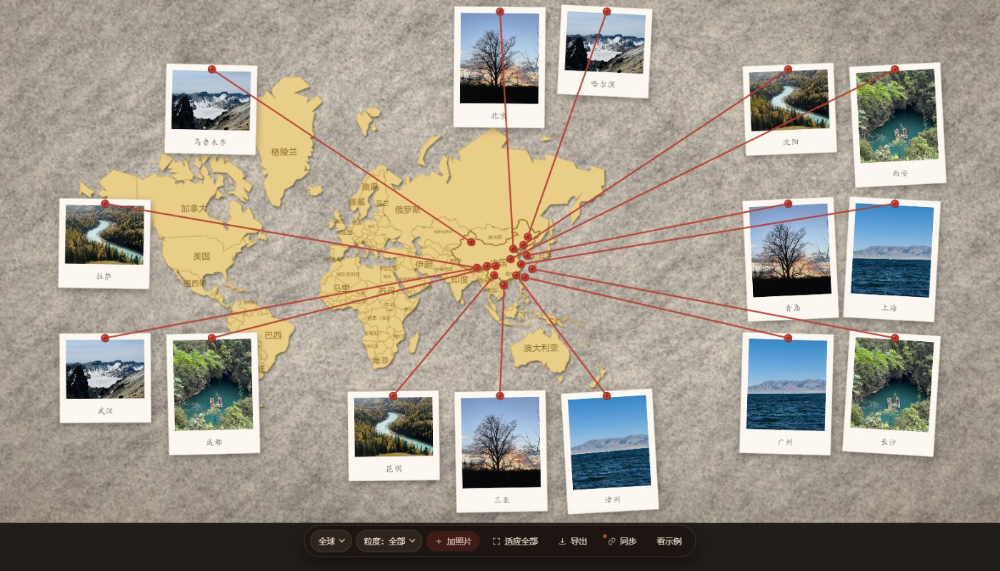
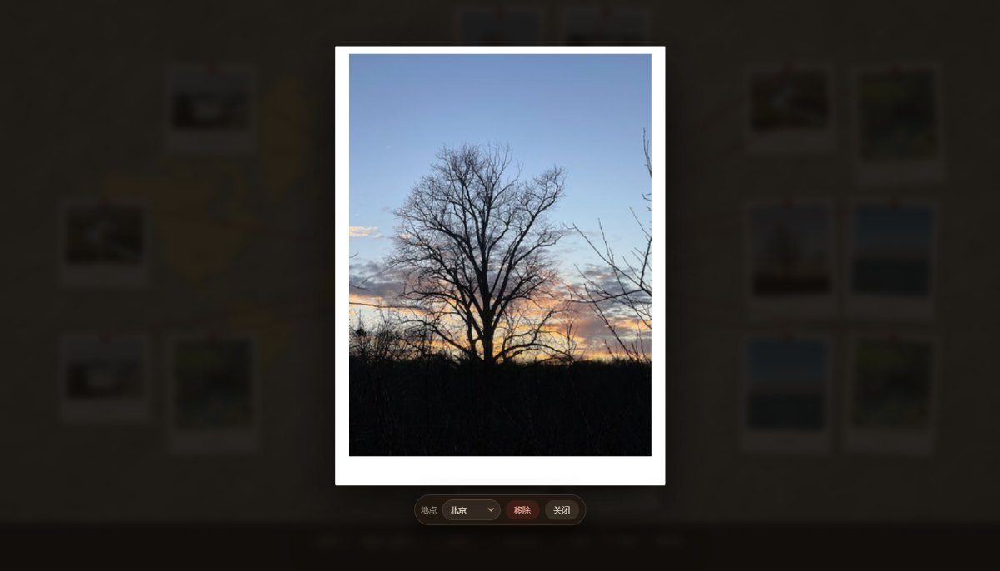
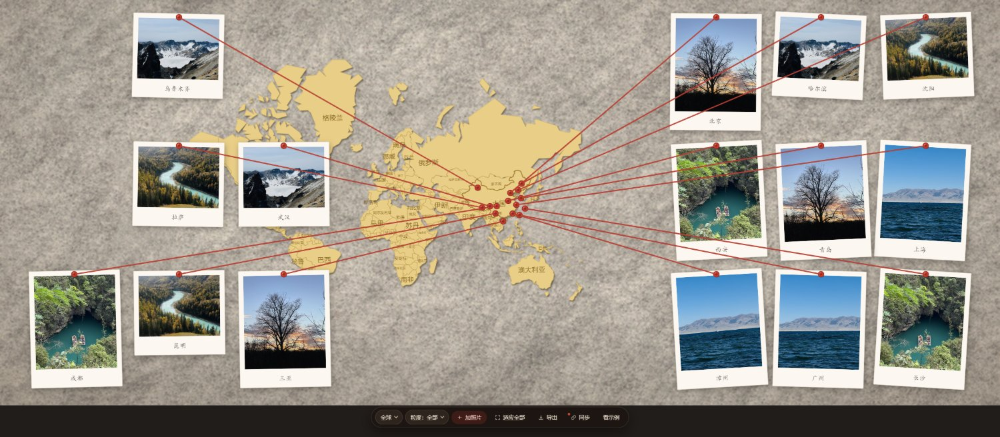

# 照片地图墙 · Photo Map Wall

把旅行照片还原成一面实体纪念墙：**毛毡板 + 实心地图件 + 红色毛线 + 拍立得**。

上传几张照片，页面自动读出照片里的 GPS，把大头针钉在地图上对应的位置，再把拍立得照片绕着地图排一圈，用红线一张张连起来 —— 线拉直、压在照片之上、彼此绝不交叉。点一下照片就能放大看原图。

纯前端，单文件，零依赖，断网可用。

**在线试用：<https://wall.orange0323.dpdns.org>** （备用：<https://photo-map-wall.pages.dev>）



---

## 目录

- [特性](#特性)
- [快速开始](#快速开始)
- [怎么用](#怎么用)
- [实现要点](#实现要点)
- [自己重新构建](#自己重新构建)
- [测试](#测试)
- [数据来源与许可](#数据来源与许可)
- [已知限制](#已知限制)

---

## 特性

- **照片带定位** —— 解析 JPEG 里的 EXIF GPS（度分秒 → 十进制度），钉到地图上的真实位置；没有 GPS 的照片按顺序分配到常用城市。
- **自动起名** —— 经纬度 → 就近城市（40 城表，120 km 内用城市名）→ 否则落到省（35 个省级面做点在多边形内判定）。
- **照片绕地图一圈** —— 按图钉落在卡片哪一侧分到四条走廊，走廊内按图钉的南北/东西序排列。
- **红线零交叉** —— 走廊槽位 + 保序 DP 指派 + 2-opt 交换，判据用真实贝塞尔折线求交，不是直线近似。
- **真毛毡、真地图件** —— 背景是真实毛毡照片（ambientCG CC0），地图是一块实心芥末黄的板件，带凸起投影、同色系省界、印着省名，没有纸卡白边。
- **画布跟随窗口** —— `viewBox` 宽度按窗口比例实时计算，不拉伸、不留黑边，任何尺寸下照片都不被裁。
- **地图可缩放平移** —— 滚轮缩放、拖动平移，「适应全部」一键回到全览，还能按省聚焦。
- **点照片看大图** —— 白边拍立得样式的大图，可改地点、回原位、移除。
- **导出 PNG** —— 高度固定 1200，宽度跟随画布比例，直接序列化 SVG 上 canvas。

| 15 张照片 | 放大看 | 宽窗口 |
|---|---|---|
|  |  |  |

---

## 快速开始

直接双击 **`index.html`**。

不需要 `npm install`，不需要起服务器，也不需要联网 —— 地图边界、毛毡纹理、示例照片全部以 base64 内联在这一个文件里。

想放到网站上，把 `index.html` 传到任意静态托管即可（Cloudflare Pages、GitHub Pages、对象存储都行）。只有这一个文件是运行必需的。

> 直接用 `file://` 打开也行：数据全部内联，没有任何 `fetch`，不会撞上 CORS。

### 部署到 Cloudflare Pages

```bash
node src/build.mjs dist/index.html            # 产物只有这一个文件
npx wrangler pages project create photo-map-wall --production-branch=main
npx wrangler pages deploy dist --project-name=photo-map-wall --branch=main
```

之后再要发布新版本，只需要重复最后一条。自定义域名在 Pages 项目里加，DNS 那边一条 CNAME 指到 `<project>.pages.dev`（橙色小云朵开着）即可。

---

## 怎么用

1. 点「**+ 加照片**」，多选照片。带 GPS 的会自动落到地图上；没有 GPS 的会按顺序分到常用城市。
2. 滚轮缩放地图，拖动地图平移；点「**适应全部**」回到全览；右上「**聚焦**」下拉可按省聚焦。
3. 点任意一张拍立得 → 打开大图预览，底部可以改「地点」、点「回原位」清掉拖动偏移、点「移除」删掉这张。
4. 照片可以**拖动**，拖走后红线实时跟着走，预览不会被误触发。
5. 点「**导出**」存成 PNG。

---

## 实现要点

**全部用 SVG 画。** 照片是 `<image>` + `clipPath`，红线是 `<path>`，地图是 `<path>`。导出时把 SVG 序列化 → `new Image()` → `canvas.toBlob()`，因此不需要 html2canvas 之类的依赖。

**画布尺寸。** 内部高度固定 `BH = 1000`，宽度 `BW` 按窗口比例算：`BW = round(clamp(1000 * innerWidth / (innerHeight - 76), 700, 3400))`，然后把这个宽高写进 `viewBox`。这样 SVG 的宽高比永远等于窗口，`preserveAspectRatio` 不会留黑边。窗口尺寸变化时整体重建（150 ms 防抖）。

**投影用墨卡托。** `u = lon`，`v = -ln(tan(π/4 + lat·π/360))·180/π`。经纬度直接当平面坐标画会让新疆和东北被横向拉长，墨卡托在中国范围内的形变可以接受（长宽比 1.31，真实约 1.34）。

**排布：走廊 + DP + 2-opt。**
1. 地图卡片居中，四边各留一条走廊（上、右、下、左，四角归左右）。
2. 每条走廊内生成统一尺寸的槽位网格 —— 槽位尺寸取所有照片旋转后外接框的最大值，所以任意照片放任意槽位都不会重叠、不会出界。
3. 槽位按绕卡片中心的方位角排序；照片按图钉的轴向坐标排序（右侧/左侧按纬度、上侧/下侧按经度）。两条序列之间用 DP 做保序最小代价指派。
4. DP 只保证「顺序一致」，不保证「线不相交」。最后跑 2-opt：任取一对红线，若真实贝塞尔折线相交就交换它们对应的照片，且只接受总长下降的交换 —— 有界单调，必然终止。

**尺寸自适应降档。** 照片内容宽从 200 px 开始，按 `200, 190, 180, …, 84` 逐档尝试，取第一个能把所有照片排下且满足「任意两张不重叠、全部在画布内」的档位。

**线是直的。** 早期版本给红线加了重力下垂（二次贝塞尔控制点下移），实测像流程图的反面 —— 线从照片中间穿过去很乱，所以改回直线。绘制顺序是「照片 → 红线」，红线压在照片上面。

---

## 自己重新构建

```bash
node src/build.mjs              # 产出 index.html
node src/build.mjs out.html     # 或者写到指定文件
```

`src/build.mjs` 把四个占位符替换进 `src/index.template.html`：

| 占位符 | 来源 |
|---|---|
| `//__CHINA_DATA__` | `data/china_coords.js` |
| `//__PROV_DATA__` | `data/provinces.js` |
| `"__FELT_URI__"` | `assets/felt-final.jpg`（base64） |
| `/*__DEMO_DATA__*/[]` | `assets/demo5/*.jpg`（base64 + 真实 GPS） |

要改界面就改 `src/index.template.html`，然后重新构建 —— **不要直接改 `index.html`**，它是构建产物。

省界数据可以离线重建（首次会联网抓一次 GeoJSON 并缓存）：

```bash
node tools/gen_provinces.mjs    # data/china_boundary_full.json（缓存）→ data/provinces.js
node tools/gen_labels.mjs       # 给每个省算省名锚点 + 内切圆半径，写回 data/provinces.js
```

示例照片从 iPhone 的 HEIC 转出（需要 `pillow-heif`，转换时会**保留 EXIF GPS**）：

```bash
python tools/heic2jpg.py "C:\path\to\heic" assets/demo5
```

---

## 测试

测试全部是 Chrome DevTools Protocol 直连 —— 不需要 Playwright/Puppeteer，Node 18+ 自带 `fetch` 和 `WebSocket`。Chrome 路径可以用环境变量 `CHROME_PATH` 指定。

```bash
node test/gen-testimg.mjs        # 生成测试图（7 张不同长宽比 + 15 张压测副本，纯 Node 写 PNG）
node test/gen-exif-cases.mjs     # 生成 9 张带已知经纬度的 EXIF 样本

node test/cdp-shot.mjs 1600 1000 shot.png   # 冒烟：打开、自检、截图
node test/cdp15.mjs                         # 15 张压测：排布 + 导出落盘
node test/cdp-cross.mjs                     # 独立复算红线交叉（不看页面自检，自己算一遍）
node test/cdp-reflow.mjs                    # 6 种窗口尺寸下重排是否越界/裁剪
node test/cdp-viewer.mjs                    # 大图预览、Esc 关闭、改尺寸后重排
node test/cdp-drag.mjs                      # 拖动照片：位置记忆、红线跟随、不误触预览、回原位

node test/test-parser.mjs       # 把页面里的 parseExifGps 抠出来，在 node 里跑 9 个样本
node test/test-demo5.mjs        # 直接读 assets/demo5 的 5 张真实照片，确认 GPS 能解出来
node test/cdp-exif2.mjs         # 真实走一遍文件上传，确认定位落到正确城市
```

想把测试跑在线上版本而不是本地文件，加一个环境变量就行：

```bash
PMW_URL=https://wall.orange0323.dpdns.org node test/cdp-shot.mjs 1600 1000 live.png
```

`__selfTest()` 在页面里可随时调用，返回照片数量、省份数、国界环数、红线数、交叉数、每张照片的包围盒以及 `issues`（重叠/出界）列表 —— 上面的脚本都是围绕它做断言的。

---

## 数据来源与许可

- **中国国界 / 省界**：阿里云 [DataV.GeoAtlas](https://datav.aliyun.com/portal/school/atlas/area_selector)。`data/china_boundary.json` 是 `100000.json` 的原始快照；`data/china_coords.js` 是它经 Douglas-Peucker 简化后的版本（17 个环、1578 点，含海南、台湾与南海诸岛）；`data/provinces.js` 由 `tools/gen_provinces.mjs` 从 `100000_full.json` 生成（35 个省级面、4180 点）。
  > 地图仅用于**可视化示意与个人纪念**，不作为任何行政区划或国界的权威依据。
- **毛毡纹理**：ambientCG 的 `Fabric034`（CC0），裁切调色后内联。
- **示例照片**：作者本人拍摄，仅作展示样例。想换成自己的照片，改 `src/build.mjs` 里的 `DEMO_META` 再重新构建即可（改成空数组就是空墙）。

代码以 MIT 许可发布，见 [LICENSE](LICENSE)。

---

## 已知限制

- **只解析 JPEG 的 EXIF GPS**。HEIC 需要先转码（`tools/heic2jpg.py`）；PNG 没有 EXIF；微信/微博转发过的图片通常已被抹掉定位，这时候只能手动选城市。
- **照片只存在于内存**。刷新页面就回到示例状态，没有本地存储、没有后端、没有账号。
- **手机触屏没适配**。缩放走的是滚轮事件，触屏手势没有处理。
- **省份到城市的粒度只有 40 个城市**。没在表里的地方会显示省名 —— 宁可显示「西藏」也不编一个不存在的地名。
- **导出是光栅化 PNG**，不是矢量 PDF；画布越高清，导出越慢。
